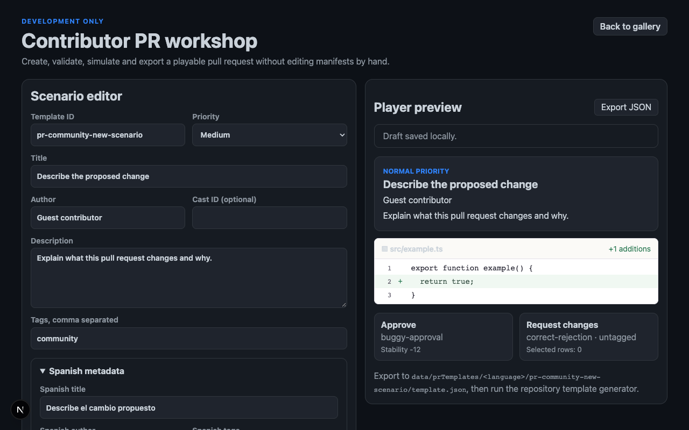

# Contributor PR workshop validation — 4 November 2026

The development-only workshop at `/dev/templates/new` lets collaborators create a scenario or duplicate one from the searchable catalog. It reuses the production diff renderer and pure decision evaluator; it has no production filesystem writer or leaderboard side effects.

## Implemented

- Metadata, author/cast identity, priority, tags and English/Spanish copy editing.
- Multi-file structured diff entry with paste support and stable raw text while typing.
- File-scoped bug annotations for kind, severity and description.
- Player preview without exposed answers, plus isolated approve/request-changes outcome simulation.
- Inline validation, safe JSON import, local draft recovery and validated JSON export with directory guidance.
- Catalog search, duplication and direct duplicate action from an existing preview.
- Updated contributor instructions in `CONTRIBUTING.md`.

## Evidence

- Valid draft create/serialize/parse/recover/export utilities have focused tests.
- Invalid JSON and invalid templates never replace the last valid draft.
- Chromium checks cover annotation, outcome changes, reload recovery, keyboard filename/diff editing, desktop and 320 px reflow, doubled text, forced colors and reduced motion.
- Independent review found focus loss from an editable React key and lost newlines from eager formatting. Both were fixed and browser-verified.
- Production checks keep `/dev/templates`, `/dev/templates/new` and individual preview routes unavailable.

